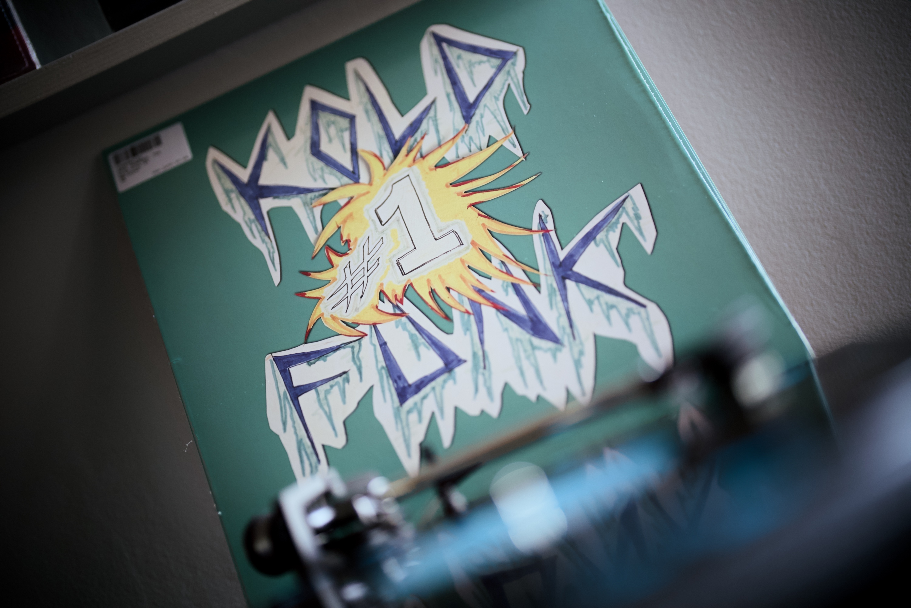
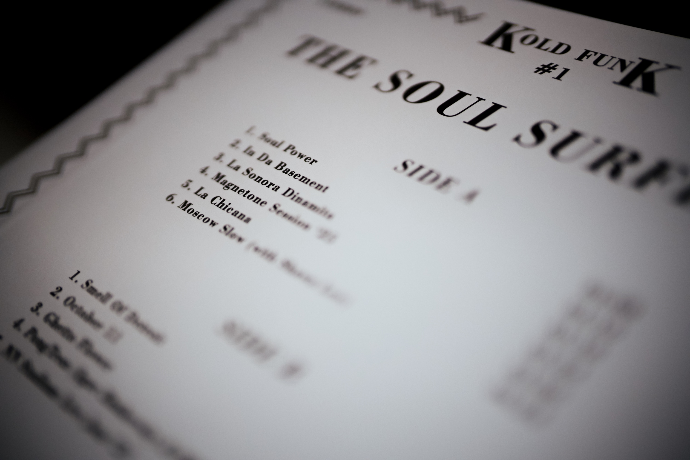

Intro...

---

## Album of the month

Other than being amazing piece of music, I have a quite complicated story with that record! It is generally hard to get one, and if it is available in one of the local stores, it is very limited.

I ordered my first copy from Juno, but it arrived damaged. Folks from Juno are good people, so in no time they sent me another copy. The new one was also damaged in a very similar way to the first one. Clearly, some faulty press batch. The third one arrived perfect, and I was so happy with it, and we kept on listening to this groovy funk a lot. Until my 3-year-old daughter decided to flip the record to the other side while the needle was still spinning on the record. As a result, she scratched the record very badly and broke one of my original Shure M44-7 needles. She is a golden kiddo, and she never destroys things for fun. It was an accident. Of course, I got a fourth copy of it, and I look after this one as if it was made of gold.

This is the end of the story of ["Kold Funk #1" by The Soul Surfers](https://www.discogs.com/release/38130234-The-Soul-Surfers-Kold-Funk-1). So, so, so good funk!



---

## Top picks

### ["A select should tell you something" by Ahmad Alfy](https://alfy.blog/2026/10/27/a-select-should-tell-you-something.html)

Customisable `select` is one of my favourite features recently added to the web platform. Browser support is already very good, but the beautiful thing about it is how progressively enhanceable this feature is. I use it in production on many projects. In this article, Ahmad shares a few great ideas about how this can be used, and some of his examples are really beautiful. Browser engineers have spoiled us in recent years with all these amazing features!

### [Introducing Adaptive Dark Mode](https://webkit.org/blog/18541/introducing-adaptive-dark-mode/)

I’m not sure what to think about this new WebKit feature that auto-applies dark mode if it is not defined by the developer. I understand that they are trying to help the end user, protect them from eye strain and still do it in a way that respects the best accessibility practices. Another voice in my head feels a little offended that some of my design decisions are going to be totally ignored and now Apple will decide how the page looks. Maybe that should be a plugin? Or maybe we should just stop ignoring user preferences and add a dark theme to our pages. Don’t know! Feels strange, but not as strange as CSS-only carousels so much loved by Googlers, but still strange.

### ["Accordion Icons: Which Work Best?" by Vitaly Friedman](https://www.smashingmagazine.com/2026/10/accordion-icons-which-work-best/)

I love this kind of post and I miss them so much. In the age of AI, folks think only about big ideas and often forget that these little details are actually the main differentiator. Here, Vitaly presents the results of research into the icons used on accordions on the web. I would love to see more of the web like this.

### ["Taming Typography: Building a Modern CSS Reset" by Stu Robson](https://css-tricks.com/taming-typography-modern-css-reset/)

I love geeking out over little things that people put into their CSS reset files. I talked about mine some time ago in ["The CSS Reset, again"](/the-css-reset-again/). This post by Stu is more typography-oriented and goes into depth about little nerdy stuff. I learned a lot from the post, but there are also tonnes of great comments underneath to go through. I literally didn't have a clue about the existence of [`font-synthesis`](https://developer.mozilla.org/en-US/docs/Web/CSS/Reference/Properties/font-synthesis) and a few others.

### ["Why there are still no non-WebKit browsers on iOS"](https://blog.mozilla.org/en/mozilla/internet-policy/apple-ios-browser-engine-rules/)

As a result of the Digital Markets Act (DMA) actions in 2024, Apple opened the door to non-WebKit browsers on iOS. But did they really? This short post on Mozilla's blog explains the real state of the situation.

### ["Browsers To Try If You’re Being Forced Off Arc" by Chris Coyier](https://blog.master.dev/browsers-to-try-if-youre-being-forced-off-arc/)

I’m not an ex-Arc user, and I’m not really after a new browser. I like defaults and, despite some of its downsides, I like and use Safari. What I found interesting about this post by Chris, is how the browser space has changed in recent years. For years, if not decades, we have been living in a world with three dominant browsers: Chrome, Firefox and Safari. Some others also existed, but they were usually based on the engines from one of the big players. The space has shifted massively. For the last few years, I have been hearing about the new VSCode fork on a weekly basis, and now it looks like the browser space is the new target category for vibe coders. This post lists so many browsers that I have never heard about. Shocking!

### [Rebirth of the WDRL — a personal take on the web’s latest](https://wdrl.info/archive/314)

Nothing on the web makes me happier than seeing good people doing good things for other good people. Anselm Hannemann is bringing back his WDRL (Web Development Reading List), and I’m really pumped that he decided to revive this project. I have been following his newsletter for a very long time, and seeing it in the age of AI, with aggregators everywhere, is awesome. Thank you for doing that, Anselm! Folks who are into web dev, this one’s an instant subscribe for you all.

### ["Ladybird is now in alpha"](https://ladybird.org/posts/alpha/)

Ladybird is not another browser based on an already existing engine. It is a brand-new engine, and the diversity that it brings to the browser space is good. I heard a lot of good things about it from people testing it out. The only thing that you want to be aware of is the [controversy behind the author](https://drewdevault.com/weird-guys/#kling).

### 
